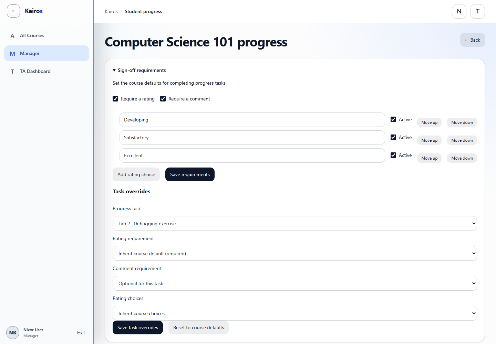

# Manager dashboard overview

## What this is for

Use the Manager area to manage assigned courses, rooms, enrollment, progress, learning content, grading, and analytics.

## How to do it

1. Select **Manager** from the Kairos menu.
2. Choose a course under **Managed courses**.
3. Review **Course settings**, **Rooms**, and **Enrollment**.
4. Use **Student progress** for roster progress.
5. Open the course itself for modules, assignments, quizzes, grading, and analytics.

**Enrollment** lists students enrolled in that course. Removing a student here removes their student enrollment for the selected course. Manage staff assignments separately.

## Set sign-off requirements

1. In **Student progress**, expand **Sign-off requirements**.
2. Switch on **Require a rating**, **Require a comment**, or both.
3. Use **Add rating choice** to enter labels such as **1.5** or **Satisfactory**. Use **Move up** and **Move down** to set the order. Clear **Active** to retire a choice.
4. Select **Save requirements** to set the course defaults for new task completions.
5. To set a different rule, select a **Progress task** under **Task overrides**. Choose which requirements to inherit and enter task-specific rating choices in display order if needed.
6. Select **Save task overrides**. Use **Reset to course defaults** to remove the task’s overrides.

Select **View** next to an enrolled student to see their recent sign-offs. A saved rating keeps the label it had when the TA recorded it.

## Download student progress

Select **Download Excel workbook** in **Student progress**. The workbook covers the selected course, including current students and retained records for former students. The **Enrollments** sheet shows **Indeterminate** when the available records cannot establish past enrollment. See **About** for counts of records excluded for conflicting links. Keep the file in approved institutional storage.

## Screenshot

## Notes

- Only Managers and Admins can use Manager controls.
- Managers can manage only their assigned courses.
- Admins can access all courses.
