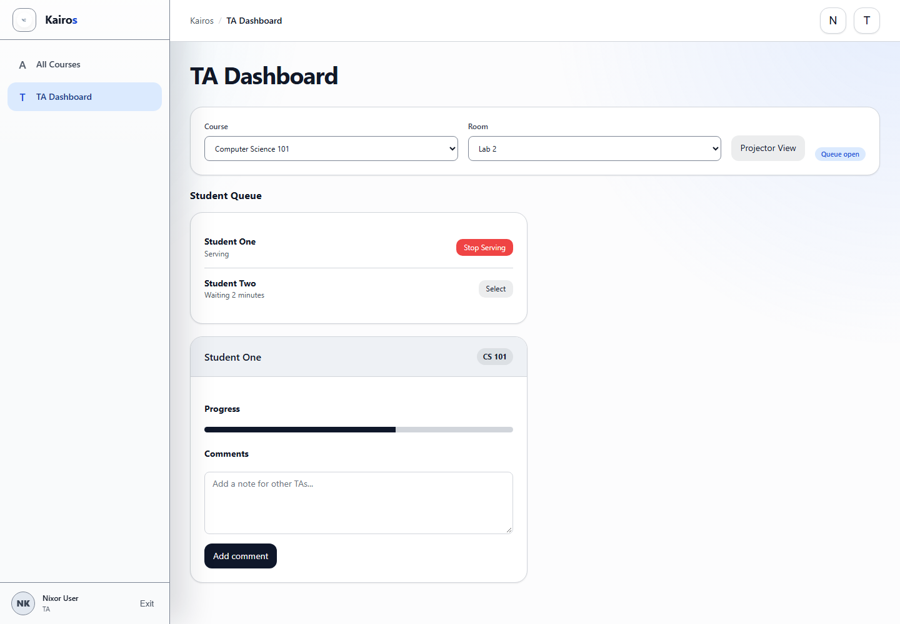
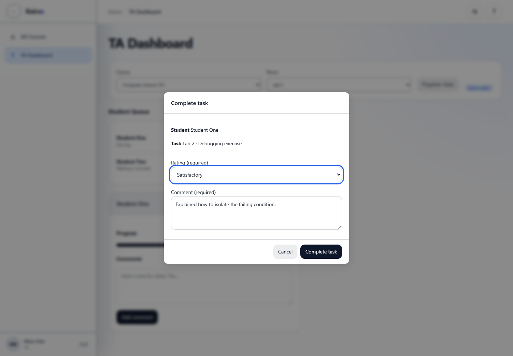

# TA dashboard overview

## What this is for

Use the TA Dashboard to select an assigned course and room, view the student queue, and review student progress.

## How to do it

1. Select **TA Dashboard** from the Kairos menu.
2. Choose a course.
3. Choose a room.
4. Review the **Student Queue**.
5. Select a Student to view progress.
6. To sign off a task, choose **Completed** next to it.
7. If the course requires a rating or comment, complete the fields marked **required** and select **Complete task**.
8. Use the separate **Comments** area when you want to leave a general note for other TAs.

## Screenshot

## Notes

- Only TAs, Managers, and Admins can open TA tools.
- The course and room lists show only available assignments.
- TA queue comments are for staff coordination.
- Use **Stop Serving** to finish your current session. If the session changed in another tab, check who is now being served before trying again.
- If the dashboard reports a temporary loading problem, reload the page and select your course and room again.
